<picture>
  <source media="(prefers-color-scheme: dark)" srcset="assets/graph-dark.svg">
  
</picture>

### Hey, I'm ibohamid10

Curious by default. I like digging into a problem until I really understand it, and then building the thing that makes it go away. Based in Vienna, mostly building web apps and small tools.

**Usually working with:** TypeScript · React · Next.js · Node.js · Python · Docker · Cloudflare

---

Most of my repos are private. Got a problem worth solving? Reach out.
<!-- Add contact links here (email, LinkedIn, website) -->
